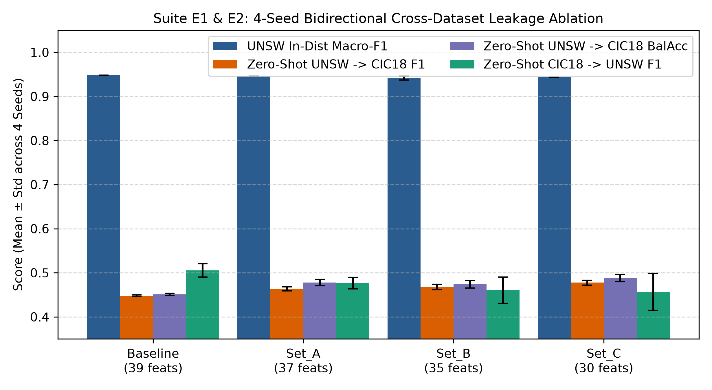
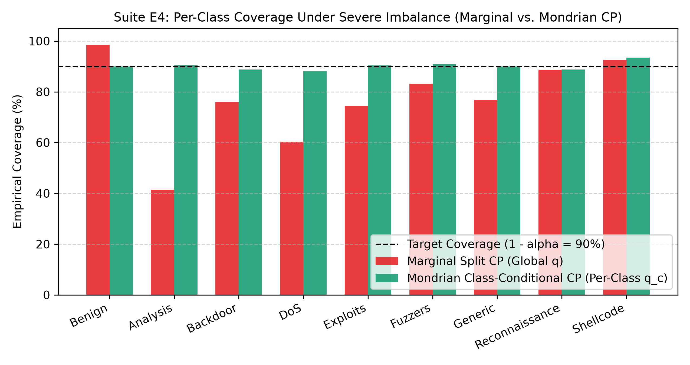
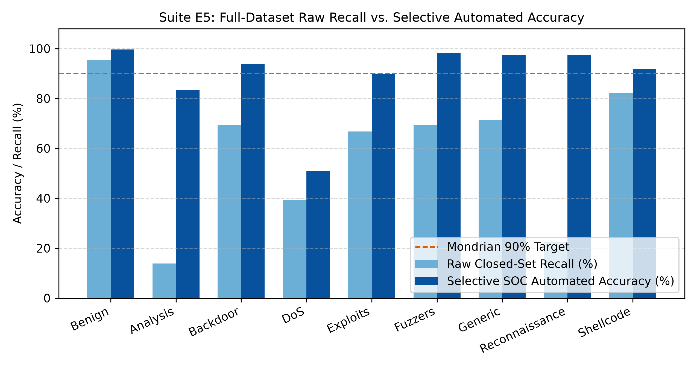

# Uncertainty-Aware & Open-Set Network Intrusion Detection System (NIDS)

Official implementation of a six-stage, leakage-safe Network Intrusion Detection pipeline evaluated on standardized 43-feature NetFlow v2 benchmarks (**NF-UNSW-NB15-v2** and **NF-CSE-CIC-IDS2018-v2**).

## Architecture Overview
1. **Forensic Data Sanitization (`src/data_forensics.py`):** Strips explicit routing identifiers and applies progressive shortcut-learning ablation (`Baseline`, `Set_A`, `Set_B`, `Set_C`).
2. **Chronological Four-Way Partitioning (`src/partitioning.py`):** Enforces temporal splitting into Proper Training ($Z_t$, 55%), Validation ($Z_v$, 15%), Calibration ($Z_c$, 15%), and Locked Evaluation ($Z_{\text{test}}$, 15%) sets.
3. **Domain-Informed Hybrid Backbone (`src/models.py`):** Enforces positive volumetric monotonicity constraints ($+1$) on byte, packet, and throughput features.
4. **Unified Open-Set Recognition (`src/open_set_evt.py`):** Combines covariance-aware Mahalanobis distances with Extreme Value Theory (Weibull tail fitting) and per-class subspace reconstruction verification ($Q_{0.96}$).
5. **Inductive Mondrian Conformal Prediction (`src/conformal_mondrian.py`):** Computes $O(N \log N)$ class-conditional p-values with Kolmogorov-Smirnov Clustered Conformal Prediction (CCP) fallback for rare attack strata.
6. **Selective SOC Triage Routing (`src/soc_triage.py`):** Partitions flows into Automated Resolution ($\mathcal{A}$) and Escalated Analyst Triage ($\mathcal{E}$) using prediction set cardinality and pairwise evidence margins.

## Key Empirical Results

### 1. Four-Seed Cross-Dataset Shortcut Ablation (Suites E1 & E2)
Progressive removal of testbed-specific header shortcuts (`Set_C`, 30 invariant features) preserves in-distribution Macro-F1 ($0.9436 \pm 0.0004$ vs. $0.9480 \pm 0.0003$) while monotonically improving zero-shot `UNSW-v2 -> CIC18-v2` Macro-F1 ($0.4479 \pm 0.0018 \to 0.4776 \pm 0.0057$) and Balanced Accuracy ($0.4509 \pm 0.0027 \to 0.4878 \pm 0.0083$) across seeds 42--45.



### 2. Marginal SCP vs. Mondrian MCP Under 2,472:1 Class Imbalance (Suite E4)
At $\alpha = 0.10$ (90% target), standard Marginal Split Conformal Prediction collapses to **41.38%** worst-class coverage (`Analysis`), whereas Mondrian Class-Conditional Conformal Prediction restores worst-class coverage to **88.02%** and mean class coverage to **90.08%**.



### 3. Full-Scale Selective SOC Triage on 1.98M Flows (Suite E5)
On the locked test split ($N_{\text{test}} = 298,154$ flows), selective triage ($\tau_{\text{hi}} = 0.25$) resolves **71.09%** of traffic autonomously at **99.31% accuracy** ($\text{AURC} = 0.0597$, $\text{FAR} = 4.20\%$), while escalating **86.59%** of unseen zero-day attacks (`Worms`) to human analysts.



## Reproducing the Experiments

```bash
# 1. Install dependencies
uv pip install -r requirements.txt

# 2. Run 100k-flow smoke test
python -u main.py --mode smoke_test --ablation Set_C --seed 42

# 3. Run full 1.98M-flow multi-class OSR, Mondrian CP, and SOC Triage evaluation
python -u main.py --mode full_unsw --ablation Set_C --seed 42

# 4. Run 4-seed bidirectional cross-dataset leakage ablation
python -u main.py --mode cross_eval --seed 42
python -u main.py --mode cross_eval --seed 43
python -u main.py --mode cross_eval --seed 44
python -u main.py --mode cross_eval --seed 45

# 5. Generate baseline comparison tables and publication figures
python -u -m src.generate_paper_artifacts